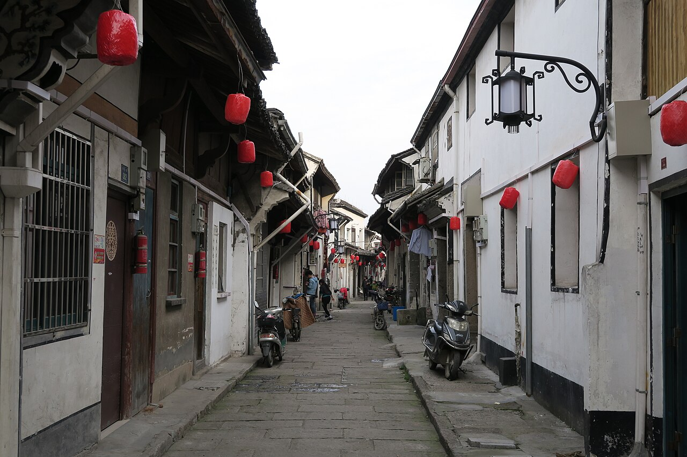
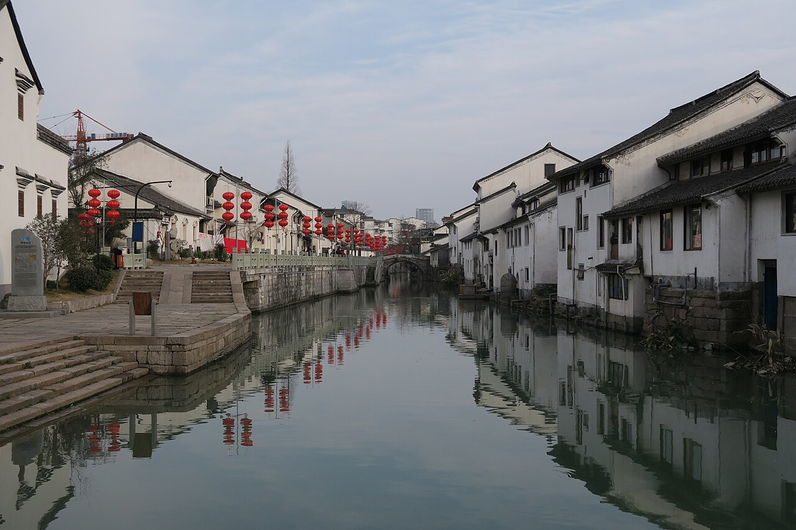

## 运河的早晨

沿着河岸走，风比街上凉一些。船从桥下慢慢过去，水纹一层层铺开，岸边的声音也跟着远了。这样的早晨，适合把手机放进口袋里。

> [!photos]
> 

原本想着走到下一座桥就回头，结果又多走了一段。只是水面有光，路边有树，脚步就自然慢下来。

## 西兴的午后

午后到了西兴。拐进老街，路一下子窄了。沿河的房子挨得很近，木门、石阶和晾着的衣服，都还在过自己的日子。

> [!photos]
>  

> [!moment] 午后随手记
> 有些日子，不需要发生什么。沿着一条河走很久，就已经很好。

喜欢这种不用找风景的地方。桥洞里的一片倒影、门边的几盆绿植，还有停在岸边的小船，回头看照片才发现自己记住的都是这些。

## 关于影像

本页是虚构的开发预览。照片取自 Wikimedia Commons，并非文中日期或时段的实拍记录：

- 运河照片：Windmemories，[查看原始作品](https://commons.wikimedia.org/wiki/File:20231122_Grand_Canal_from_Gongchen_Bridge.jpg)，CC BY-SA 4.0。
- 西兴巷道与水岸照片：Siyuwj，[照片 02](https://commons.wikimedia.org/wiki/File:Xixing_Town,_2015-02-14_04.JPG)、[照片 03](https://commons.wikimedia.org/wiki/File:Xixing_Town,_2015-02-14_03.JPG)，CC BY-SA 4.0。
